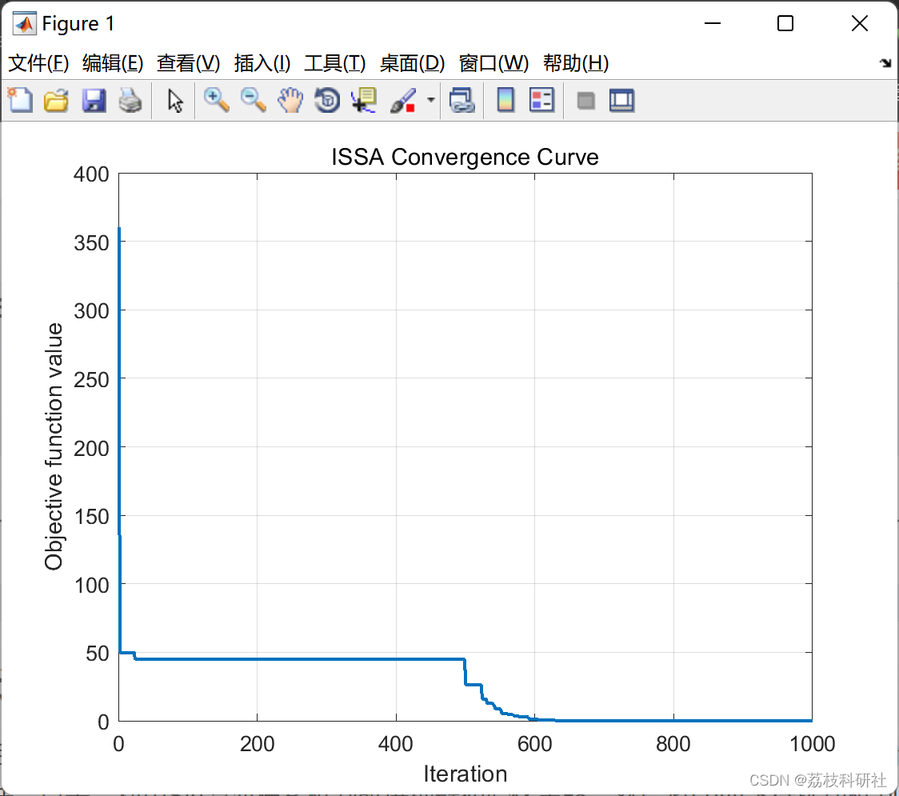
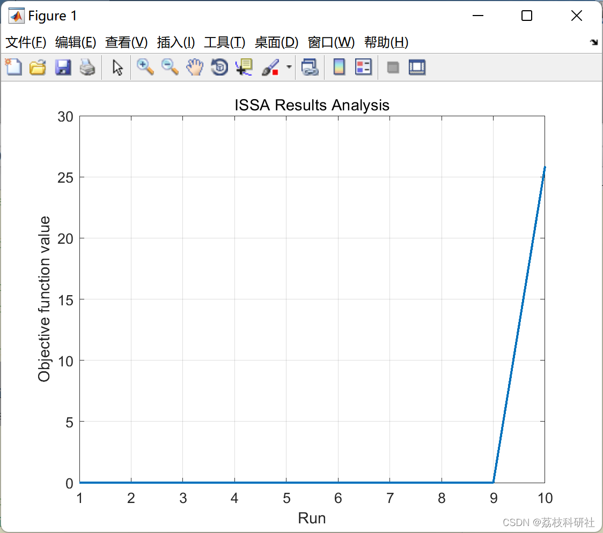

# Sparrow Search Algorithm (ISSA) Based on Levy Flight Perturbation Strategy (Matlab Code Implementation)

📚2 Running Results Edit
Edit:
Part of the code:
function [FoodFit,FoodPos,ConvCurve]=ISSA(Ntot,Ninit,tMax,LoB,UpB,Nvars,fobj)  
%% Set parameters  
% Percentage (nSOF) / number (NSOF) of individuals that are replaced by  
% the Survival of the Fittest Mechanism  
nSOF = 0.05; NSOF = round((1-nSOF) * Ntot);  
% Min. and Max. Mutation Probability value  
pMUTmax = 0.15 ; pMUTmin = 0.1;  
% Min. and Max. Crossover Probability value  
pCRSmax = 0.25 ; pCRSmin = 0.1;  
% Min. and Max. Numberof Exploring Salps  
NexpMax = round(Ntot * 0.5); NexpMin = 1;  
%% Initialization  
ConvCurve = zeros(1,tMax);  
FoodPos = zeros(1,Nvars);  
SalpFit = zeros(Ninit,1);  
%% Initialize the positions of salps
nPos = ceil(Ninit/2);  
Pos = rand(nPos,Nvars).*(UpB-LoB)+LoB;  
OpPos = UpB + LoB - Pos;  
SalpPos = [Pos;OpPos];  
if mod(Ninit,2)  
SalpPos(end,:)=[];  
end  
for i=1:Ninit  
SalpFit(i,1)=fobj(SalpPos(i,:));  
end  
[SalpFit,sortIndex]=sort(SalpFit);  
SalpPos = SalpPos(sortIndex,:);  
SalpPos(Ntot+1:end,:) = [];  
SalpFit(Ntot+1:end,:) = [];  
FoodPos = SalpPos(1,:);  
FoodFit = SalpFit(1);  
ConvCurve(1) = FoodFit;  
%% Main loop  
t = 2; % First iteration was the initialization  
while t <= tMax  
% Compute c1 parameter  
c1 = 2 * exp(-(4 * t / tMax) ^ 2);  
% Compute Nexp (exploring salps number),  
%     pMUT (mutation probability),  
%     and pCRS (crossover probability).  
Nexp = round(NexpMax * (t / tMax) + NexpMin); % Pun un round aici  
pMUT = pMUTmax * (1- t / tMax) + pMUTmin;  
pCRS = pCRSmax * t / tMax + pCRSmin;  
for i = 1 : Ntot  
% Update the leader and the exploring salps  
if i <= Nexp  
for j = 1 : Nvars  
c2 = rand(); % Random weights  
c3 = rand(); % Random number to decide the sign  
c4 = rand; % Random number to decide if crossover applies  
% Update the exploring salps using the first variant of crossover  
if c4 < pCRS / 2  
SalpPos(i,j) = FoodPos(j) * c2 + SalpPos(i,j) * (1 - c2);  
% Update the exploring salps using the second variant of crossover  
elseif c4 < pCRS  
SalpPos(i,j) = FoodPos(j) * (1-c2 / 2) + SalpPos(i,j) * (c2 / 2);  
% Update the exploring salps using the equation from the leader salp  
else  
if c3 < 0.5 % Decide the sign + or -  
SalpPos(i,j) = FoodPos(j) + c1 * ((UpB(j) - LoB(j)) * c2 + LoB(j));  
else  
SalpPos(i,j) = FoodPos(j) - c1 * ((UpB(j) -LoB(j)) * c2 + LoB(j));  
end  
end  
end % for j = 1 : Nvars  
% Update the follower salps  
elseif  i > Nexp && i < NSOF  
% The first follower salp is guided by the Food Position  
if i == Nexp + 1  
Salp1 = FoodPos;  
% All the others are guided by the previous salp  
else  
Salp1 = SalpPos(i-1,:);  
end  
Salp2 = SalpPos(i,:);  
if rand() > pMUT  
% The new position is determined as weighted average between  
% the previous and current salp  
r1 = rand(); % Random weight  
SalpPos(i,:) = Salp2 * r1 + Salp1 * (1 - r1); % fara 1/2 asta!!!!!  
% Mutation is applied with the pMUT probability  
else  
r1 = rand(1,Nvars); % Random weight  
r2 = sign(rand(1,Nvars) - 0.5); % Random number to decide the sign  
SalpPos(i,:) = SalpPos(randi(Ntot),:) + r1 .* (r2 .*(UpB-LoB)+LoB) * c1;  
end  
% Eliminate the weakest salps and replace them with new random  
% salps  
elseif i>=NSOF && i<=Ntot  
SalpPos(i,:) = rand(1,Nvars) .* (UpB - LoB) + LoB;  
end  
% Enforce Boundaries by replacing the value that violates a limit  
% with the violated limit  
Fupb=find(SalpPos(i,:)>UpB);  
Flob=find(SalpPos(i,:)<LoB);  
SalpPos(i,Fupb) = UpB(1,Fupb);  
SalpPos(i,Flob) = LoB(1,Flob);  
% Compute the salp fitnes  
SalpFit(i,1) = fobj(SalpPos(i,:));  
% If necessary update the Food Position and Fitness  
if SalpFit(i,1) < FoodFit  
FoodPos = SalpPos(i,:);  
FoodFit = SalpFit(i,1);  
end  
end % for i = 1 : Ntot  
% Sort the salps  
[SalpFit,sortIndex] = sort(SalpFit);  
SalpPos = SalpPos(sortIndex,:);  
% Update the converge curve  
ConvCurve(t)=FoodFit;  
if 0% mod(l,10) == 0  
display([t,FoodFit]);  
end  
% Increment iteration  
t = t + 1;  
end % while t <= tMax  
end % function  
🎉3 References
problem using an improved salp swarm algorithm  
🌈4 Matlab code implementation

## Images

<!-- PAYMENT_BLOCK -->

## Get this dataset

- Payment link (Stripe): [Buy now](https://buy.stripe.com/3cs8yP7sY87d0vu9AB)
- Payment QR code: 

<!-- /PAYMENT_BLOCK -->
